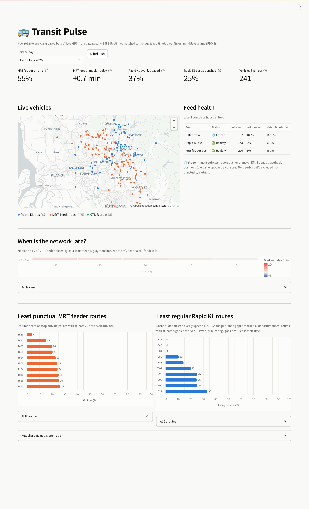

# 🚌 Transit Pulse

**Batch + streaming analytics platform for Malaysian public transit.**

Transit Pulse ingests live vehicle positions (GTFS-Realtime) and published
timetables (GTFS static) for Rapid KL, MRT feeder buses and KTMB from
[data.gov.my](https://developer.data.gov.my/realtime-api/gtfs-realtime), and
turns them into answers like:

- Which routes are consistently late, and at what time of day?
- Do "every 15 minutes" buses actually come every 15 minutes, or bunch up?
- When is the network most delayed?



---

## Architecture

```
 GTFS-Realtime API (every 30s)              GTFS Static (daily zip)
          │                                          │
  transit.producer (Python)                 Airflow: gtfs_static_ingest
          │                                          │
   Redpanda / Kafka  ── topic: gtfs.vehicle_positions │
          │                                          │
          ├─► transit.bronze_sink ───────►  Data lake (SeaweedFS / S3, Parquet)
          │                                  bronze/      raw, as received
          └─► Spark Structured Streaming ─►  silver/      cleaned, deduplicated
              parse → validate → dedupe      quarantine/  rows that failed a check
                                             gold/        analytics marts
                                                     │
                              dbt + DuckDB warehouse (hourly, via Airflow)
                              staging → core facts/dims → performance marts
                                                     │ export after every build
                                             gold/*.parquet (in the lake)
                                                     │
                              Streamlit dashboard (DuckDB in-memory over Parquet)
```

### Data lake layout

| Layer  | Path | Written by |
|--------|------|------------|
| bronze | `bronze/vehicle_positions/feed=*/dt=*/hour=*/part-*.parquet` | `bronze_sink` (micro-batches) |
| bronze | `bronze/gtfs_static/feed=*/dt=*/gtfs.zip` | Airflow |
| silver | `silver/gtfs_static/<table>/feed=*/dt=*/data.parquet` | Airflow |
| silver | `silver/vehicle_positions/feed=*/event_date=*/` | Spark Structured Streaming |
| quarantine | `quarantine/vehicle_positions/processed_date=*/dq_reason=*/` | Spark Structured Streaming |
| gold | `gold/<mart>.parquet` | dbt `on-run-end` hook, after tests pass |

### Data quality: what silver guarantees

Every vehicle position goes through these checks (`spark/jobs/transforms.py`).
Rows that fail are **not dropped silently**. They go to `quarantine/` with the
reason and the original payload, so they can be counted, alerted on and replayed.

| Rule | Quarantine reason |
|------|-------------------|
| JSON parses and has an `event_id` | `unparseable_or_missing_event_id` |
| Vehicle id, timestamp and GPS position present | `missing_vehicle_id`, `missing_event_ts`, `missing_position` |
| Position inside Malaysia (catches `0,0` "null island" fixes) | `position_outside_malaysia` |
| Speed between 0 and 160 km/h | `negative_speed`, `implausible_speed` |
| Timestamp not more than 5 min in the future | `event_in_future` |
| No duplicates: one row per `event_id` (15-minute watermark) | dropped as duplicate |

**Finding: the speed unit is wrong at the source.** The GTFS-Realtime spec says
`speed` is in metres/second. Comparing reported speed with the speed implied by
consecutive GPS fixes (2,148 pairs of moving buses) gave a median ratio of
**3.30 (Rapid KL)** and **3.45 (MRT feeder)**. That's close to 3.6, the km/h↔m/s
factor, so these feeds send km/h. Silver stores `speed_kmh`, a corrected `speed_mps`,
and the untouched `speed_reported_raw`.

**Finding: KTMB speed is a placeholder.** Every KTMB position reports exactly `90.0`
(160 of 160 rows), and each train stayed at one fixed position for two hours. Read as
m/s, that's 324 km/h and the rows were all quarantined as `implausible_speed`. Instead,
KTMB speed is now stored as null (raw value kept), so positions are judged on their
own. The frozen positions are tracked as a freshness check for Phase 4.

**What the quarantine caught in its first live run** (13,570 events):

| Rows | Reason | Root cause |
|------|--------|------------|
| 67 | `position_outside_malaysia` | GPS "null island" fixes at (0, 0) from KTMB and MRT feeder buses |
| 2 | `event_in_future` | Bus `VAL4552` reported a timestamp in **2029**: a broken device clock |

**Replayable by design.** After the KTMB rule changed, silver and quarantine were rebuilt
from scratch by deleting the output and checkpoints and letting Spark re-read the Kafka topic.

**Finding: broken column at the source.** In the Rapid Rail GTFS `stops.txt`, the
`geometry` column contains the literal text `"[object Object]"` (a JavaScript
serialisation bug upstream). It is kept in silver as-is and excluded in modeling.

### Key design decisions

- **Natural event key.** `event_id = feed:vehicle_id:timestamp`. The API repeats a
  vehicle's last position on every poll until it reports again, so this key is
  what makes deduplication possible.
- **At-least-once delivery.** The Kafka producer is idempotent (`acks=all`), and
  the sink commits offsets only *after* a Parquet file is safely written. A crash
  can cause duplicates but never data loss, and duplicates are removed downstream.
- **Exactly-once silver.** Spark keeps Kafka offsets and dedupe state in a checkpoint,
  and the Parquet sink only exposes committed files (`_spark_metadata`). A restart
  resumes exactly where it stopped, with no gaps or double counting. Locally the
  checkpoint lives on a Docker volume (it needs real directory renames). In the cloud
  it moves to GCS or HDFS via `SPARK_CHECKPOINT_DIR`. Readers must use Spark, or
  respect `_spark_metadata`, so they never see files from a failed micro-batch.
- **Silver is partitioned by the Malaysian local day** (`event_date`), because that's how
  riders and planners think about service. Timestamps themselves stay in UTC.
- **Bronze is partitioned by ingestion time.** It is append-only, so any hour can
  be reprocessed. Event-time partitioning happens in silver.
- **Idempotent batch jobs.** Each Airflow run writes to paths keyed by its logical
  date, so re-runs and backfills overwrite instead of duplicating.
- **Strings in, types later.** Silver GTFS tables keep source values as strings.
  Casting happens in dbt, where it is tested and documented.
- **S3 API everywhere.** Locally the lake is [SeaweedFS](https://github.com/seaweedfs/seaweedfs),
  an open-source S3-compatible store. MinIO stopped publishing free Docker images in 2025.
  Version 4.x is required: 3.x reported folders as files to Spark's S3A connector.
  The code only speaks the S3 API, so switching to AWS S3 just means unsetting `S3_ENDPOINT_URL`.
- **Fail per feed.** Dynamic task mapping runs one task per feed, so a broken KTMB
  feed doesn't block Rapid KL.

---

## Warehouse and metrics (dbt + DuckDB)

dbt models in `warehouse/` read the silver Parquet **in place** from the lake (DuckDB
`read_parquet` over S3, no copy) and build a star schema in a DuckDB file. Airflow's
`transit_dbt_build` DAG runs `dbt build` hourly, so every model is tested before
anything downstream uses it.

```
staging (views)            core (tables)                 performance (tables)
stg_lake__vehicle_positions ─► fct_vehicle_positions
stg_gtfs__stop_times ─┐        fct_stop_arrivals ──────┬─► mart_route_on_time_daily
stg_gtfs__trips ──────┼─► int_gtfs__trip_stops ─┘      ├─► mart_network_delay_hourly
stg_gtfs__stops ──────┘                                └─► mart_stop_headways ─► mart_route_headway_daily
stg_gtfs__routes ────────► dim_route (SCD Type 2)
                           dim_stop
```

### The core problem: the feeds don't say when a bus reached a stop

GTFS-Realtime here only has GPS positions. `fct_stop_arrivals` infers stop visits by
matching each ping to its trip's scheduled stops. Profiling the real data shaped the rules:

| Finding | Rule it led to |
|---|---|
| **94% of MRT feeder trips are loops** (first stop = last stop), so a ping at the terminal matches two stop occurrences, which first produced a −26 to +24 min delay spread | Each ping is assigned to **one** stop occurrence: the one closest to its scheduled time. The spread tightened to −5 / +10 min (p10/p90). |
| Outbound and return roads often run side by side | A ping must be ≤ 150 m from the stop. Matches > 30 min from schedule are treated as **mismatches, not delays**. |
| Several pings near the same stop (dwelling) | Keep the closest ping per stop visit. |
| MRT feeder's realtime `route_id` (`T852`) ≠ its own GTFS `route_id` (`30000068`), but `trip_id` matches 100% | Route always comes from the trip in the timetable. The public number lives in `route_long_name`, so `route_name` falls back to it. |
| MRT feeder sends no trip start date | Service day is derived from local time (handles trips after midnight). |

A warn-level test (`assert_stop_arrivals_in_order`) tracks matching quality: about 2% of
visits are out of sequence by more than 10 minutes (1.6% MRT feeder, 2.4% Rapid KL,
over the first 2.5 hours).

### Two kinds of service → two kinds of reliability metric

| Operator | Timetable style | Metric |
|---|---|---|
| MRT feeder buses | Exact time per stop (`stop_times`) | **On-time performance**: delay = observed − scheduled. On time = 1 min early to 5 min late (industry standard). |
| Rapid KL buses | "Every N minutes" (`frequencies`) | **Headway adherence** between consecutive **departures**: evenly spaced (0.5–1.5× the scheduled gap), bunched (< 0.5×), gaps (> 1.5×), plus **Excess Wait Time**, the extra minutes a rider waits versus the schedule, as used by Transport for London |

#### A metric I got wrong first, and how I caught it
The first version measured Rapid KL headways **at stops**, from GPS-inferred stop visits. The
dashboard then showed riders waiting **+27 minutes** longer than promised, which is implausible.
Digging in:

1. Only **34%** of each trip's stops had a matched visit. Buses report about once a minute while
   stops are a few hundred meters apart, so most stop passes fall between two pings. Every missed
   pass made the gap at that stop look twice as long: median **2.04×** the scheduled headway.
2. The feed also reports each trip's **actual departure time**. Gaps between consecutive
   departures don't depend on catching a bus near a stop: median **1.23×**.
3. That still included gaps that started **before data collection began** that day (buses that
   left and finished unseen). Dropping those gave a median of **1.06×**.
4. Excess Wait Time stayed high (≈ +13 min), driven by a few 2-hour gaps that may be buses
   running with GPS off. So the dashboard **leads with the robust share of evenly spaced
   departures** and shows Excess Wait Time only as detail, with that caveat.

The stop-based model was deleted; `int_frequency_dispatches` documents why.

KTMB is excluded from performance metrics because its positions are frozen placeholders (see above).

### Modeling choices
- **`dim_route` is SCD Type 2, rebuilt from the daily GTFS snapshots in the lake**,
  not from dbt snapshots, so history is reproducible no matter when dbt ran. Facts join
  on `service_date ∈ [valid_from, valid_to)`.
- **Each service day uses the timetable that was valid that day**
  (`int_gtfs__snapshot_for_service_date`), so timetable changes don't rewrite history.
- **Incremental facts** (`delete+insert`) reprocess a one-day lookback, so trips that
  cross the cut-off are rebuilt completely.
- **Tests:** 40+ data tests (uniqueness, ranges, SCD2 integrity, metric percentages that
  must sum to 100), source freshness, and a **dbt unit test** for the headway logic
  (bunching, gaps, and loop buses that must not count as a headway).

Query the warehouse:

```bash
docker compose exec airflow-scheduler /opt/dbt-venv/bin/python -c "import duckdb; duckdb.connect('/opt/airflow/warehouse/transit_pulse.duckdb', read_only=True).sql('select * from performance.mart_route_on_time_daily order by pct_on_time limit 10').show()"
```

---

## Dashboard

**http://localhost:8501**: a Streamlit app (`dashboard/`) that reads the **gold** Parquet marts
and live silver positions straight from the lake with an in-memory DuckDB:

- **Headline KPIs:** MRT feeder on-time share and median delay; Rapid KL evenly spaced and
  bunched departures; vehicles live now
- **Live map** of every bus reporting in the last 10 minutes, colored by operator
- **Feed health:** status per feed with icon + label (KTMB shows as 🧊 Frozen)
- **Delay heatmap** by hour of day (diverging scale: blue early, gray on time, red late)
- **Route rankings:** least punctual MRT feeder routes and least regular Rapid KL routes,
  with hover details and full table views

Design choices:
- **Gold layer instead of querying the warehouse.** DuckDB allows one writer, so a dashboard
  reading the warehouse file would hit lock errors whenever dbt runs. dbt exports the serving
  marts to Parquet after each build (`macros/export_gold.sql`), and only tested data gets there.
- **Accessible color.** Operator colors are fixed by identity and checked for color vision
  deficiency (worst pair ΔE 9.2 under deuteranopia). Every color also has a text label or
  table view, and statuses always pair an icon with a word.
- **The live map lists before it reads.** Opening every silver file written today took 8 s.
  Listing today's folder and reading only files from the last 12 minutes takes about 2 s.

**Found while building it: Spark wrote ~10 tiny files a minute.** Each micro-batch's dedupe
shuffle spread rows over 4 tasks, and each task wrote its own file per feed. Repartitioning by
the output partition before writing cut that to 2–3 files a minute, one per feed.

---

## Operations: monitoring, alerting and maintenance

| Airflow DAG | Schedule | What it does |
|---|---|---|
| `gtfs_static_ingest` | daily 03:00 | Timetables → bronze/silver |
| `transit_dbt_build` | hourly :15 | dbt models + tests |
| `pipeline_health` | every 15 min | End-to-end health checks + alerting |
| `bronze_compaction` | hourly :40 | Merge small bronze files |

### Health checks (`pipeline_health`)
Each check answers "is data still flowing through this stage?":

| Check | Limit | Catches |
|---|---|---|
| Bronze freshness | 2× flush interval + 5 min | Producer, Kafka or sink down |
| Silver freshness | 10 min | Spark job down or stuck |
| `bronze-sink` consumer lag | 20,000 msgs | Sink falling behind |
| Quarantine rate (last hour) | 5% | A feed starts sending bad data (baseline ≈ 1%) |
| Timetable freshness | 26 h | Daily GTFS download failing |

**Alerts fire on state changes only** (healthy → failing, failing → recovered), so an
outage produces one alert, not one every 15 minutes. Every DAG also alerts when a task
fails after its last retry. Set `ALERT_WEBHOOK_URL` in `.env` to a Discord or Slack
incoming-webhook URL. Without one, alerts are only logged.

### Data health in the warehouse (dbt)
`monitoring.mart_feed_health_hourly` tracks, per feed and hour, active vehicles, **frozen
vehicles** (reporting but not moving) and the trip-match rate. Two warn-level tests watch it:
- `assert_feeds_not_frozen`: most of a feed's vehicles stopped moving. KTMB is on a
  known-issues list (`known_frozen_feeds`), so the test catches **new** breakages instead of
  warning forever. With the list emptied, it flags KTMB immediately (verified).
- `assert_trip_match_rate`: realtime trips stop matching the timetable (e.g. a new GTFS
  was published but the download failed). The baseline is 97–100%.

### Small-file compaction (`bronze_compaction`)
The sink writes a file every few minutes, which means about 12 files per feed per hour.
Each closed hour is merged into one file. The job is **idempotent and safe to re-run**:
the output name is a hash of its inputs, inputs are deleted only after the output's row
count is verified, and rows are deduplicated on Kafka (partition, offset). First live run:
70 files → 21, with the row count unchanged (35,318).

## Cloud infrastructure (Terraform)

`infra/terraform/` defines the Google Cloud setup. It's validated in CI and ready to `apply`:

- **GCS data lake** with public access blocked, plus lifecycle rules: bronze moves to
  Nearline after 30 days and is deleted after 1 year; quarantine is deleted after 90 days.
- **BigQuery datasets** matching the dbt schemas (`staging`, `core`, `performance`, `monitoring`, …)
- **A least-privilege service account**: object admin on *this* bucket and data editor on
  *these* datasets only, not project-wide.
- **Optional budget alert** at 50/90/100% of a monthly MYR amount.

```bash
cd infra/terraform
cp terraform.tfvars.example terraform.tfvars   # set project_id
terraform init && terraform plan
```

---

## Quick start

**Requirements:** Docker Desktop (4 GB+ RAM allocated) and Python 3.11+ for tests.

```bash
cp .env.example .env
docker compose up -d --build
```

| Service | URL | Login |
|---------|-----|-------|
| **Dashboard** | http://localhost:8501 | none |
| Airflow | http://localhost:8080 | `admin` / `admin` |
| Redpanda Console (Kafka UI) | http://localhost:8085 | none |
| SeaweedFS file browser (data lake) | http://localhost:8888/buckets/transit-lake/ | none |
| Spark UI (Structured Streaming tab) | http://localhost:4040 | none |

Then:

1. Open **Redpanda Console** → Topics → `gtfs.vehicle_positions` to watch live buses arriving.
2. In **Airflow**, unpause `gtfs_static_ingest` and trigger it.
3. In the **SeaweedFS file browser**, open the `transit-lake` bucket. Bronze Parquet files from the
   stream appear every `SINK_FLUSH_SECONDS` (5 min by default).

### Run pieces without Docker

```bash
python -m venv .venv
.venv/Scripts/activate        # Windows  (macOS/Linux: source .venv/bin/activate)
pip install -r requirements-dev.txt

# Peek at live data without Kafka:
cd ingestion && python -m transit.producer --once --dry-run
```

### Tests and linting

```bash
pytest -v
ruff check .

# Spark transform tests run inside the Spark image (no local Java needed)
docker compose run --rm --no-deps spark-streaming python3 -m pytest -v tests
```

CI runs both on every push and PR (`.github/workflows/ci.yml`).

---

## Roadmap

- [x] **Phase 1, Ingestion:** GTFS-RT producer → Kafka → bronze; Airflow GTFS static → bronze/silver
- [x] **Phase 2, Stream processing:** Spark Structured Streaming: validation + quarantine, dedupe on `event_id` with event-time watermark, speed-unit fix, silver vehicle positions
- [x] **Phase 3, Warehouse and modeling:** dbt on DuckDB (reads the lake in place): GPS→stop matching, `dim_route` SCD2, on-time performance and headway/Excess Wait Time marts, data and unit tests, hourly Airflow DAG
- [ ] **Phase 3b, Cloud warehouse:** same dbt models on BigQuery (external tables over GCS), provisioned with Terraform
- [x] **Phase 4, Production hardening:** end-to-end health checks with state-change alerting (Discord/Slack), feed health mart + frozen-feed and trip-match tests, idempotent bronze compaction, Terraform for GCS/BigQuery/IAM validated in CI
- [x] **Phase 5, Serving:** gold Parquet layer + Streamlit dashboard (live map, feed health, delay heatmap, route rankings)
- [ ] **Next:** hosted dbt docs, multi-day trends once more history accumulates, BigQuery deployment via the Terraform in `infra/`

## Data source and licence

Data from the Malaysian Government Open Data portal (data.gov.my), provided
under the [Creative Commons Attribution 4.0](https://creativecommons.org/licenses/by/4.0/) licence.
